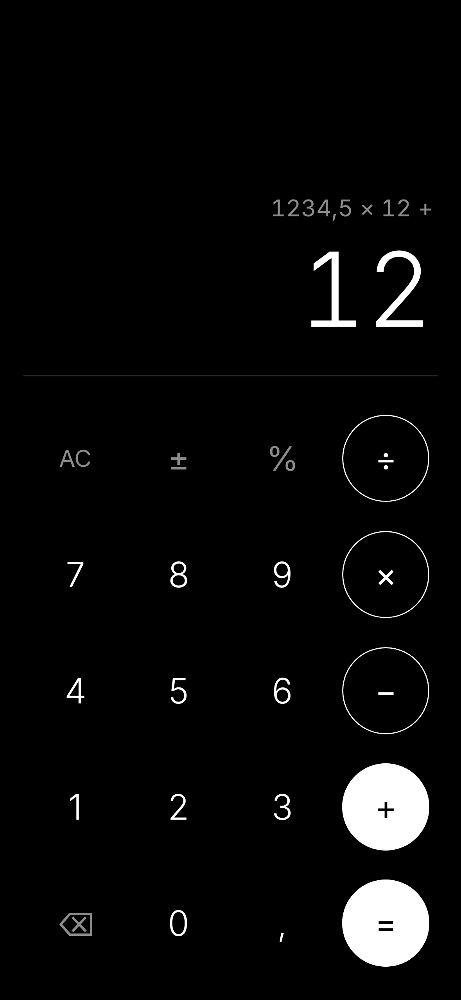
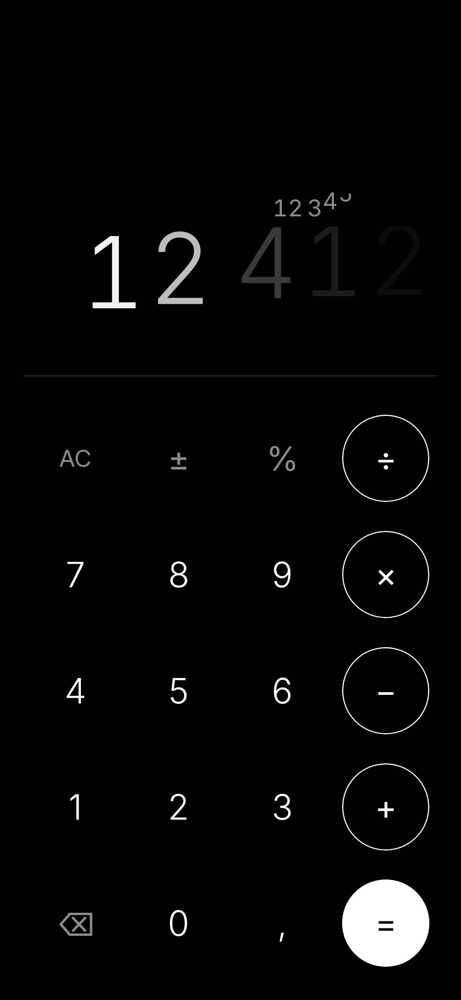

# Минималистичный калькулятор

Простой калькулятор для Android в строгом чёрно-белом стиле. Без градиентов, теней и цветных акцентов: только типографика и сетка.

<p align="center">
  
  &nbsp;&nbsp;
  
</p>

## Возможности

- **Минималистичный дизайн.** Чистый чёрный фон, шрифт Inter, крупные тонкие цифры, которые уменьшаются, если число не помещается.
- **Точная арифметика.** Вычисления на `BigDecimal`: `0,1 + 0,2 = 0,3`, без «плавающего мусора».
- **Приоритет операций.** `2 + 3 × 4 = 14`, цепочки вычислений, `%`, `±`, `⌫`, AC/C. Деление на ноль показывает «Ошибка».
- **Анимация AC.** Цифры плавно «испаряются» одна за другой.
- **Отзывчивые клавиши.** Нажатие срабатывает при касании, поэтому быстрый ввод и ввод несколькими пальцами не теряются.
- **Никаких разрешений.** Приложение работает полностью офлайн, без доступа к сети и без резервного копирования данных.
- **Около 1 МБ.**

## Требования

- Android 7.0 (API 24) или новее
- Для сборки: JDK 17 и Android SDK (platform 36, build-tools 36)

## Сборка

```bash
./gradlew assembleRelease   # APK: app/build/outputs/apk/release/app-release.apk
./gradlew testDebugUnitTest # юнит-тесты и скриншот-тесты (Robolectric)
```

Если `keystore.properties` отсутствует, release-сборка подписывается отладочным ключом. Чтобы подписать своим ключом, скопируйте `keystore.properties.example` в `keystore.properties` и укажите путь к keystore и пароли. Файл в `.gitignore`.

`./build-apk.sh` собирает release, переподписывает его схемами v1, v2 и v3, проверяет выравнивание 16 КБ и кладёт результат в `Calculator.apk`. Ему нужен `keystore.properties`.

## Стек

Kotlin, Jetpack Compose, ViewModel. Тесты: JUnit, Robolectric, Roborazzi.

## Лицензия

[MIT](LICENSE) © 2026 Deku San

Шрифт [Inter](https://rsms.me/inter/) распространяется по лицензии SIL Open Font License 1.1, см. [third_party/Inter-OFL.txt](third_party/Inter-OFL.txt).
